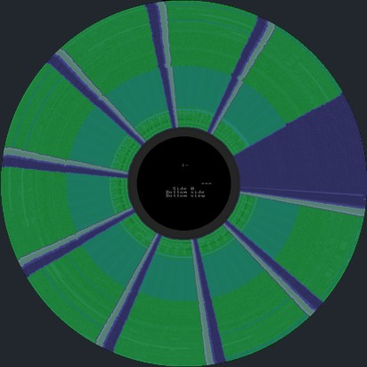
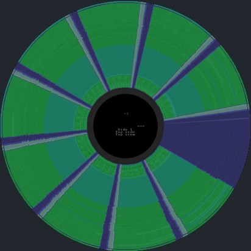

# Noise Disk,  

[The Last Dimension (Compjoetania)[DMK].zip](https://download.file-hunter.com/Music/Music%20Discs/The%20Last%20Dimension%20(Compjoetania)[DMK].zip)  
[The Last Dimension (Compjoetania).zip](https://download.file-hunter.com/Music/Music%20Discs/The%20Last%20Dimension%20(Compjoetania).zip)  
 

## The Copy Protection:

This demo comes on a double sided_disk.

This disk has 2 unformatted tracks.  
Track 1 (Side 1), Sector 1 is tested in the startmenu of the demo after the countdown is 0.  
Track 79 (Side 0 & 1), Sector 6 is tested in the end credits.  

If the copy protection detects these tracks are readable, it will show this message “THIS IS AN ILLEGAL COPY”  
and the software will crash with a DI, HALT instruction.  
  

 
  
 
  
  
## How to defeat the copy protection and create a normal .DSK file: 

Use a HexEditor to Find and Replace the following bytes to disable the copyprotection.  

Check1 `0E F9 06 01 11 1B` replace with `18 1C 06 01 11 1B`

Check2 `0E F9 06 01 11 9C` replace with `18 0F 06 01 11 9C`  

 
 

## Note:
If all this was too difficult, 
- You can copy the original Noise Disk with AllCopy (Special-Optie enabled).